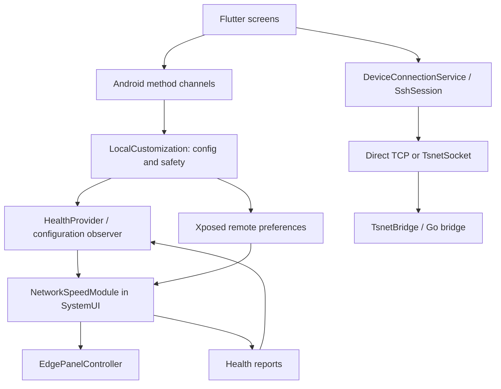

# Code map

Start with the current owner for the feature. Search for symbols rather than relying on fixed line numbers.

## Architecture and process boundaries



The indicator and edge panel live inside SystemUI. The Node Cockpit app owns settings, native bridges and the embedded tailnet node. Restarting the app can terminate its transport sessions. Root backend health and Xposed hook health are distinct.

## Feature index

| Area | Start here | Supporting owners / search symbols |
|---|---|---|
| Startup and theme | [main.dart](../lib/main.dart) | appSettings.load; RemoteControlApp; LocalCustomizationScreen; asynchronous tsnet startup |
| Local customization dashboard | [local_customization_screen.dart](../lib/screens/local_customization_screen.dart) | _openFeature; _apply; _liveNetworkSetting; _flushNetworkSettings; _tuningSlider |
| Platform registration | [MainActivity.kt](../android/app/src/main/kotlin/com/example/remote_control/MainActivity.kt) | configureFlutterEngine; dispose/cleanup lifecycle; native terminal view factory |
| Customization channel | [CustomizationBridge.kt](../android/app/src/main/kotlin/com/example/remote_control/CustomizationBridge.kt) | single worker; apply and applyVisual; launcherApps |
| Settings and safety | [LocalCustomization.java](../android/customization/src/main/java/com/nodecockpit/customization/LocalCustomization.java) | config; save; applyVisual; hookConfiguration; hookConfigurationBundle; publish; probeRootBackground; acceptRootHealth; saveSetup; updateSetup; restoreSetup; checkpoint |
| Indicator renderer | [NetworkSpeedModule.java](../android/customization/src/main/java/com/nodecockpit/customization/NetworkSpeedModule.java) | attach; placeMeter; positionFloatingMeter; render; drawColumn; protectLineSpacing; requestConfiguration; acceptSettings |
| Free-position collision solver | [StatusBarPlacement.java](../android/customization/src/main/java/com/nodecockpit/customization/StatusBarPlacement.java) | resolve; native system-icon container and leaf bounds cached on layout, checked before draw; nearest free slot; hide only when no slot fits |
| Indicator preview | [network_indicator_preview.dart](../lib/customization/network_indicator_preview.dart) | drag callbacks; example traffic; design and unit formatting; preview is not measured phone traffic |
| Saved setup picker and scoped updates | [saved_setup_sheet.dart](../lib/customization/saved_setup_sheet.dart), [SavedSetupScope.java](../android/customization/src/main/java/com/nodecockpit/customization/SavedSetupScope.java) | adaptive save/restore sheets; stable setup IDs; per-feature ownership; updateSetup merges persisted choices without applying; restoreSetup merges one saved feature into current live config before validated apply |
| Immutable hook settings | [IndicatorSettings.java](../android/customization/src/main/java/com/nodecockpit/customization/IndicatorSettings.java) | formatUnit; defaults/clamps; feature signatures |
| Compatibility and policy | [FeaturePolicy.java](../android/customization/src/main/java/com/nodecockpit/customization/FeaturePolicy.java) | HOOK_VERSION; supported; validLayout; safetyLeaseValid; rateParts |
| Health transport | [HealthProvider.java](../android/customization/src/main/java/com/nodecockpit/customization/HealthProvider.java) | SystemUI UID checks; configuration/wakeConfiguration/report; revision and failure metrics |
| Dashboard health labels | [customization_health.dart](../lib/customization/customization_health.dart) | indicatorStatus; customizationChecks; separate desired enablement from runtime visibility |
| Edge panel, handle and editing | [EdgePanelController.java](../android/customization/src/main/java/com/nodecockpit/customization/EdgePanelController.java) | Card Glass panel, Native Glass handle, window lifecycle, app and folder editing, placement and actions |
| Standalone Liquid Glass engine and lab | android/liquid-glass-engine, android/liquid-glass-demo, glass-lab | Independent renderer and preview app. |
| Upgrade compatibility | RetiredGlassSettings.java | Clears retired SystemUI glass choices and keeps valid edge material and search tray settings. |
| Edge panel text tone | [text_tone_control.dart](../lib/customization/text_tone_control.dart), [TextTone.java](../android/customization/src/main/java/com/nodecockpit/customization/TextTone.java) | System tone or user-selected grayscale. |
| Recovery / boot | [RecoveryReceiver.java](../android/customization/src/main/java/com/nodecockpit/customization/RecoveryReceiver.java), [BootRecoveryJobService.java](../android/customization/src/main/java/com/nodecockpit/customization/BootRecoveryJobService.java) | CustomizationApplication; watchdog backend assets; emergency/rollback paths |
| Device connection | [device_connection_service.dart](../lib/devices/device_connection_service.dart) | host-key verification, identities, TCP/tsnet socket selection; device_lifecycle_controller.dart; device_host_connector.dart |
| SSH sessions and terminal | [ssh_session.dart](../lib/ssh/ssh_session.dart), [ssh_session_manager.dart](../lib/ssh/ssh_session_manager.dart) | run; openShell; WindowsCommandHost; persistent_terminal.dart; native_terminal.dart; NativeTerminalBridge.kt |
| Commands and stateful controls | [controls_screen.dart](../lib/screens/controls_screen.dart), [stateful_controls_controller.dart](../lib/stateful/stateful_controls_controller.dart) | remote_command.dart; command_editor/; status_batcher.dart; stateful_command_executor.dart |
| Remote desktop / media / input | [remote_desktop.dart](../lib/services/remote_desktop.dart) | remote_desktop_screen.dart; desktop_surface.dart; remote_media.dart; remote_keyboard.dart; remote_screenshot.dart; RemoteAudioBridge.kt |
| Files and transfers | [sftp_screen.dart](../lib/screens/sftp_screen.dart), [file_transfer_queue.dart](../lib/services/file_transfer_queue.dart) | download_store.dart; upload_store.dart; DownloadBridge.kt; UploadBridge.kt |
| Embedded Tailscale | [tsnet_client.dart](../lib/transport/tsnet_client.dart), [TsnetBridge.kt](../android/app/src/main/kotlin/com/example/remote_control/TsnetBridge.kt) | tsnet_socket.dart; native/tsnet/bridge/node.go; see native README |
| Background ADB protection | [AdbRelayService.kt](../android/app/src/main/kotlin/com/example/remote_control/AdbRelayService.kt), [TsnetNetworkMonitor.kt](../android/app/src/main/kotlin/com/example/remote_control/TsnetNetworkMonitor.kt) | session-scoped foreground service, bounded wake lock, stop action, shared process network-observer leases; separate from SSH keep-alive |
| Temporary remote ADB | [AdbRelaySession.kt](../android/app/src/main/kotlin/com/example/remote_control/AdbRelaySession.kt), [debug_relay.go](../native/tsnet/bridge/debug_relay.go) | tailscale_screen.dart; duration/reset; guarded root listener; [ADB guide](REMOTE_ADB.md) |
| Updates | [app_update.dart](../lib/services/app_update.dart), [AppUpdateBridge.kt](../android/app/src/main/kotlin/com/example/remote_control/AppUpdateBridge.kt) | app_update_screen.dart; app_updates_settings_screen.dart; build_update.ps1; [update guide](REMOTE_UPDATES.md) |
| Persistence and identity | [app_settings.dart](../lib/services/app_settings.dart) | device_storage.dart; identity_storage.dart; credential_storage.dart; known_host_storage.dart; preserve SSH host-key checks |

## Settings flow and editing contract

1. Flutter updates local config optimistically. Network edits use one in-flight operation and one latest pending value, not an unbounded queue. Older native responses/probes must not rewind newer edits.
2. `CustomizationBridge` dispatches off the UI thread. Enable/disable uses `apply` and its safety checks. Appearance/content uses `applyVisual`.
3. `LocalCustomization.save` validates, persists, and increments revision. `publish` writes Xposed remote preferences; the configuration URI notifies the SystemUI observer.
4. `NetworkSpeedModule.requestConfiguration` fetches off the main thread; `acceptSettings` checks revisions then updates views on SystemUI's main thread. It compares edge signatures to avoid rebuilding unrelated surfaces.
5. Hook health returns through the UID-restricted provider. A dashboard label is a snapshot, not proof of current pixels. Configuration revision and observed hook revision can temporarily differ.
6. Background root shell collection must not hold the visual configuration lock. Newer explicit checks supersede earlier background results. Root authorization, heartbeat freshness, quarantine and leases remain enforced.

### Adding a customization setting

Update all applicable hops: Flutter control/preview, `LocalCustomization.config/save/publish/hookConfigurationBundle`, `IndicatorSettings` field/default/clamp, renderer and relevant feature signature. Bump HOOK_VERSION only when injected code changes. Validate numeric/string/boolean JSON types. Preserve defaults when opening existing installations.

### Important indicator keys

- Visibility/data: enabled, showUpload, showArrows, hideIdle, intervalMs (hook: interval), thresholdKB (hook: threshold), units, decimals.
- Placement: position(left/right anchor), horizontalPosition(-1 anchored;0..1000 preferred free position), verticalOffset.
- Design/type: indicatorDesign, layout, boldValue, boldText, textSize, stackedTextSize, indicatorHeight, rateWidth.
- Spacing/units: iconGap, arrowGap, arrowScale, directionGap, unitLabel, unitSuffix, unitGap(-4..8), unitScale.
- Edge settings are validated in LocalCustomization and IndicatorSettings.

## Behavioral sequences

See the [behavior guide](BEHAVIOR_GUIDE.md) for sleep/wake timing, settings acknowledgements, restart/quarantine/rollback, edit persistence, SSH reconnect, transfer cancellation, relay cleanup and deployment boundaries. Its evidence labels distinguish source-checked behavior from phone observations.

## Lifecycles and boundaries to preserve

- SystemUI restarts require reattachment to its recreated status-bar window. Wake recovery is separate from boot recovery. Native hooks continue independently of the Flutter route.
- Preserve separate handle and panel geometry and gesture state. Network-only edits do not rebuild these windows.
- Keep rate counter baselines across cosmetic changes. Do not infer effective visibility solely from enabled=true.
- A dragged indicator position is a preference, not an absolute overlay coordinate. Native icon/cutout bounds constrain the drawn position; dynamic corrections are not persisted. Recheck visibility before drawing, including when room returns. Native system-icon containers are included because their own/virtual drawing may not appear in leaf Views. Cached native bounds are refreshed on layout rather than rediscovering hierarchy per frame.
- App tailnet identity differs from the official Tailscale VPN app. Preserve it across app updates. ADB sessions are temporary; root restoration must retain guards if cleanup is incomplete.
- Preserve SSH host-key verification, signing identity, updater downgrade protection, saved credentials and user-selected settings.

## Search recipes

```powershell
rg -n 'positionFloatingMeter|placeMeter|iconWidth' android/customization/src/main/java
rg -n 'unitGap|horizontalPosition' lib android/customization/src/main/java
rg -n 'MethodChannel|when \(call.method\)' android/app/src/main/kotlin
rg -n 'probeRootBackground|acceptRootHealth|applyVisual' android/customization/src/main/java
rg -n 'connect\(|TsnetSocket|verifyHostKey' lib/devices lib/transport
```

## Maintenance

Read this map, then only the owner files for the task. Verify names and behavior in code before implementation. Add a row for new feature ownership; document new process boundaries and lifecycle decisions here. Keep event order, timing and failure propagation in BEHAVIOR_GUIDE.md, reproduction details in DEBUGGING.md and deployment evidence in CODEX_HANDOFF.md. Do not copy entire implementations into prose.
